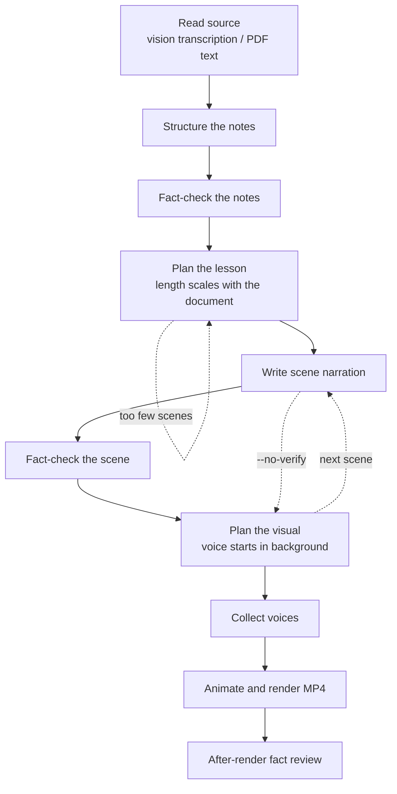

# NoteTutor AI

**Turn your notes into a narrated, animated explainer video.**

Upload handwritten notes, a PDF, a text file - or just type a topic - and
NoteTutor plans a short lesson, writes the narration, designs a visual for
every scene (process flows, cycles, trees, bar and line charts, comparison
tables, concept maps, key points,
equations) and renders an MP4 in which each element appears and is
highlighted exactly when the narrator talks about it.


| Comparison table | Recap with key points |
|---|---|
|  |  |

## Features

- **Any material**: handwritten pages (vision model transcription), PDFs
  (text layer or scanned), `.txt`/`.md`, or a topic name.
- **Grounded teaching**: lessons stay within the source; a fact check runs on
  the notes and on every scene, and an after-render review lists any
  doubtful sentence with its timestamp.
- **Visuals chosen per scene** by the shape of the content: process flows
  (order), cycles (loops), trees (categories), bar and line charts (numbers
  stated in the narration, checked), comparison tables, concept maps, key
  points, typeset equations and licensed pictures. Every box shows a name
  and a short description - laid out by
  a deterministic engine (no overlapping boxes or labels).
- **Synced animation**: elements appear one at a time, at the moment the
  narrator names them (even several in one sentence); the item being
  explained is spotlighted and pulses, bars grow, and dots flow along arrows.
- **Natural narration**: Kokoro neural voice (local), equal loudness per
  sentence, background music that ducks under speech.
- **Sensible length**: about 2 minutes for a page of notes, at most ~10
  minutes for long documents.
- **Web app**: accounts, live progress, video player and download, script and
  fact review, admin dashboard.
- **Free to run**: Groq and Gemini free tiers, local voice and rendering.

## Tech stack

| Area | Technologies |
|---|---|
| Backend | Python, FastAPI, REST, JWT + httpOnly session cookie, role-based access control, Pytest |
| Database | MongoDB (users, lessons) with GridFS for notes and videos; MongoDB Atlas or local |
| Frontend | React, TypeScript, Vite, Tailwind CSS, React Router, Vitest |
| Video pipeline | Pillow, NumPy, MoviePy / FFmpeg, matplotlib (equations), Kokoro / Piper TTS |
| AI | Groq (`gpt-oss-120b`, `gpt-oss-20b`, `qwen3.8-27b` vision), Google Gemini (fallback) |
| AI orchestration | LangGraph (pipeline state machine with SQLite checkpoints), LangChain (chat models, fallback chain), LangSmith (tracing, evaluation experiments) |
| DevOps | Docker, Docker Compose, Nginx, GitHub Actions |

## Quick start (Docker)

```bash
git clone https://github.com/akshaykumar1828/Notetutor.git
cd Notetutor
cp .env.example .env        # add GROQ_API_KEY, JWT_SECRET and MONGO_URL
```

Download the voice model (see [docs/DEVELOPMENT.md](docs/DEVELOPMENT.md#voice-models)),
then:

```bash
docker compose up --build                    # with MongoDB Atlas (MONGO_URL set)
docker compose --profile local-db up --build # or with a local MongoDB container
```

Open <http://localhost:8080>, create an account (the first account becomes
the admin) and generate a lesson.

## Command line

```bash
python -m app.pipeline.lesson_video samples/agentic_ai_notes.jpeg
python -m app.pipeline.lesson_video "How DNS resolution works"
python -m app.pipeline.lesson_video notes.pdf -o lesson.mp4 --no-music
```

| Option | Effect |
|---|---|
| `-o PATH` | output file (default `data/video/<title>.mp4`) |
| `--no-captions` / `--no-music` | turn off captions / background music |
| `--no-verify` | skip the per-scene fact check (uses less quota) |
| `--no-review` | skip the after-render review file |
| `--fresh` | ignore cached AI answers |
| `--allow-local` | continue with a local Ollama model if the online models are unavailable |

## How it works

The pipeline is a LangGraph state machine. Every step is checkpointed, so a
run that fails (for example when the free AI quota runs out) resumes from
the failed step on "Try again" instead of starting over.



Model calls go through LangChain chat models (Groq, then Gemini, then an
optional local Ollama model) with free-tier rate-limit handling; set
`LANGSMITH_TRACING=true` to trace every step in LangSmith.
Details: [docs/ARCHITECTURE.md](docs/ARCHITECTURE.md).

## Evaluation

| Measure | Result |
|---|---|
| Layout engine, 1,200 random plans | 100% no overlaps, in bounds, correct connectors |
| Handwriting transcription (CER) | 19.3% local baseline -> 0-3.5% current |
| Narration sync | 100% of elements shown during their sentence, A/V drift 45 ms |
| Faithfulness (LLM judge) | 0% of claims contradict the source |

Method and limitations: [evaluation/RESULTS.md](evaluation/RESULTS.md).
Pipeline versions can also be compared as LangSmith experiments:
`python -m evaluation.langsmith_eval data/video/<lesson>.json --name <version>`.

## Project structure

```
app/
  api/           FastAPI app: auth, lessons, admin, background worker
  pipeline/      LangGraph lesson pipeline (graph.py) and CLI entry point
  vision/        page transcription and structure extraction
  teaching/      lesson planning
  content/       scene narration and sentence splitting
  knowledge/     fact checks
  video/         visual planning, layout engine, animator, renderer
  audio/         text-to-speech and background music
  common/        LangChain model client (Groq, Gemini, Ollama), paths
frontend/web/    React + TypeScript web app (Vite, Tailwind)
evaluation/      evaluation scripts and results
tests/           Pytest suite (API, layout, narration sync, ingestion)
samples/         example handwritten notes
docs/            architecture and development guides
```

## Development

Setup, environment variables, running without Docker and tests:
[docs/DEVELOPMENT.md](docs/DEVELOPMENT.md).

```bash
pytest                          # backend (no API keys or database needed)
cd frontend/web && npm test     # frontend
```
